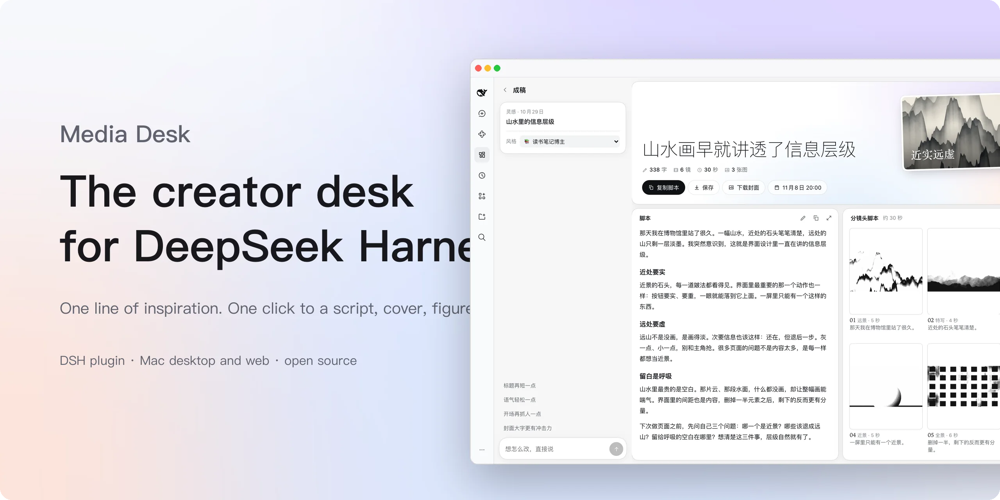
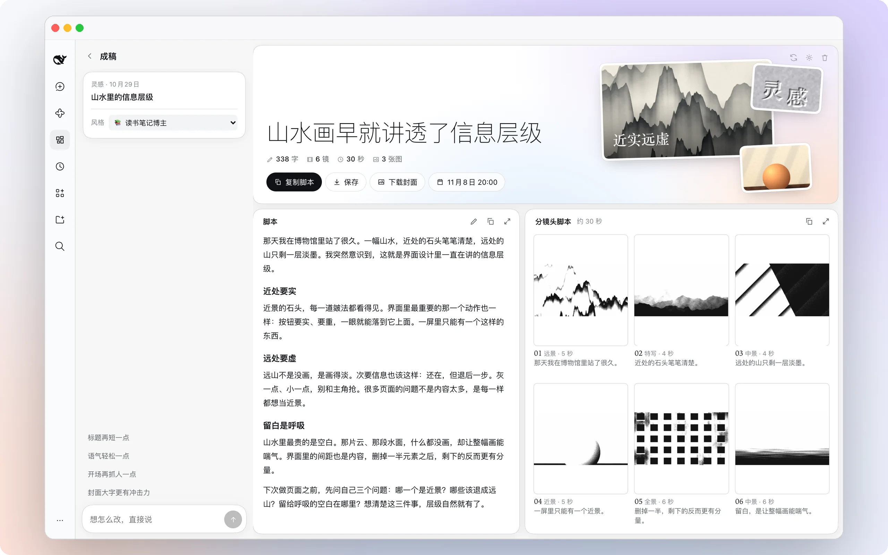
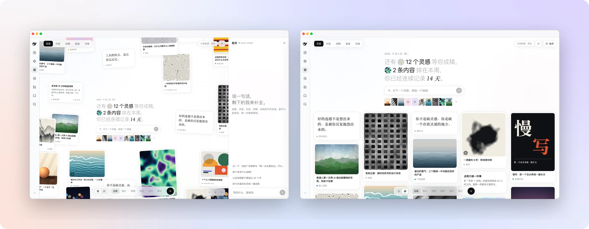
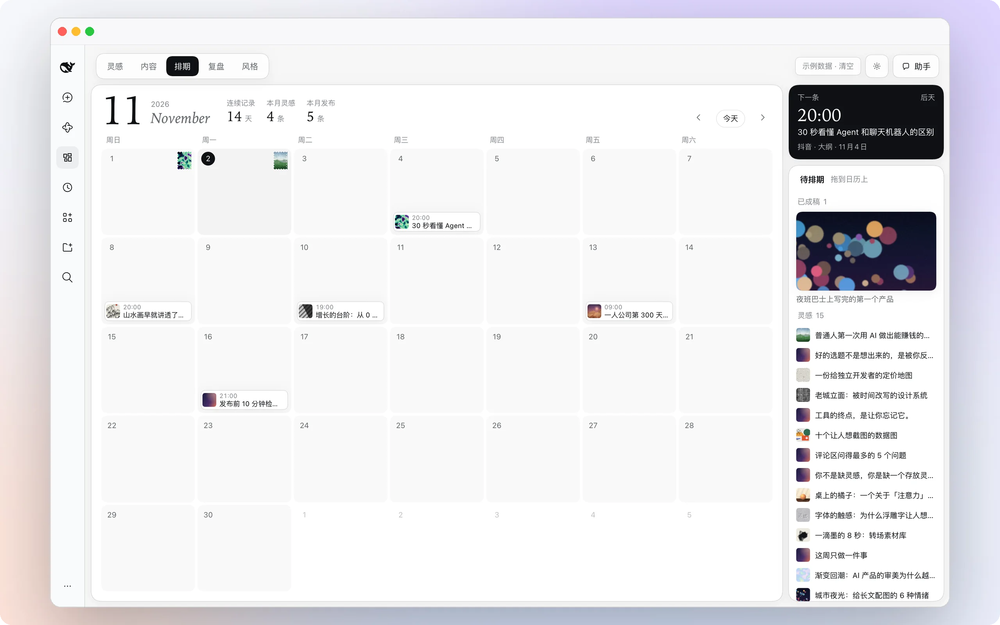
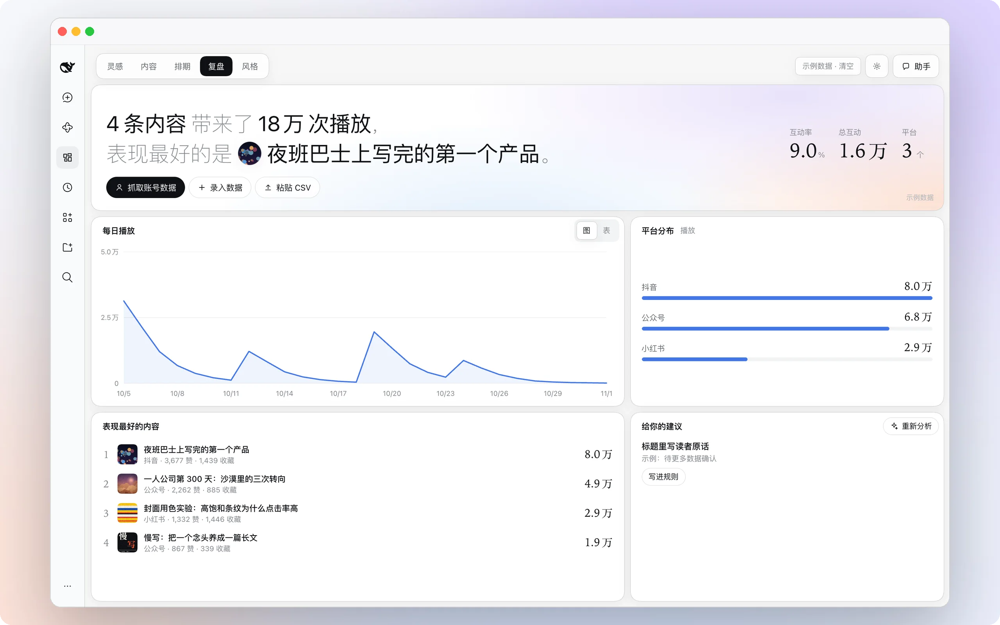
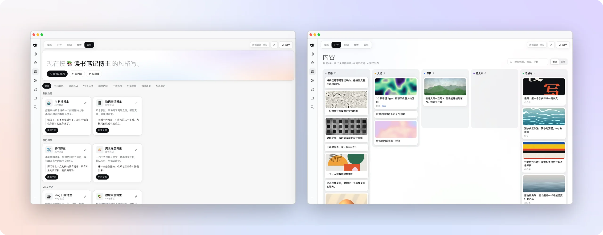

<p align="center">
  <picture>
    <source media="(prefers-color-scheme: dark)" srcset="docs/assets/hero-en-dark.webp">
    
  </picture>
</p>

<h1 align="center">Media Desk</h1>

<p align="center"><b>A DeepSeek Harness plugin. Jot an idea; one click makes the script, cover, figures and storyboard.</b></p>

<p align="center">Built by <a href="https://www.xiaohongshu.com/user/profile/5faedce8000000000101c8a3"><b>蜗牛的科技笔记</b></a>, a tech creator on Xiaohongshu, as the desk for their own daily publishing.</p>

<p align="center">
  <a href="https://github.com/woniuniuniu/dsh-media-desk/releases/latest">Download</a> ·
  <a href="#three-steps">Three steps</a> ·
  <a href="#what-it-costs">What it costs</a> ·
  <a href="#questions">Questions</a> ·
  <a href="README.md">简体中文</a>
</p>

<p align="center">
  
  
  <a href="LICENSE"></a>
  <a href="https://github.com/woniuniuniu/dsh-media-desk/stargazers"></a>
</p>

<br>

## What it is

A page in the DeepSeek Harness sidebar. It opens on a wall of ideas, one line each. Open any of them and one click produces a spoken script, a title, a video cover, figures and a line-art storyboard; chat on the left and the right side changes. Drag the finished piece onto the calendar, publish, come back for the numbers.

Five pages: **Ideas · Content · Schedule · Insights · Styles**. The interface is in Chinese.

<br>

## One-click production

<table>
<tr>
<td width="62%">
  <picture>
    <source media="(prefers-color-scheme: dark)" srcset="docs/assets/f-studio-dark.webp">
    
  </picture>
</td>
<td valign="top">
<p><b>The whole page grows at once.</b></p>
<p>The grid is laid out the moment you open an idea. Title, script, video cover, figures and six storyboard frames are generated together and fill in as they arrive.</p>
<p><b>Say it, and it changes.</b></p>
<p>"Make it more direct", "shot 3 from above", "bolder cover text". The right side updates live; every step can be undone.</p>
<p><b>Take it with you.</b></p>
<p>Edit the script in place, copy it, or save everything, cover, figures and frames included, as one folder.</p>
</td>
</tr>
</table>

<br>

## The idea wall

<table>
<tr>
<td valign="top" width="38%">
<p><b>One line, one idea.</b></p>
<p>Text, links, images, videos and quotes become cards. Scatter them on an infinite canvas or switch to a time-sorted feed.</p>
<p><b>An assistant on the right.</b></p>
<p>"Produce today's best idea", "what's scheduled next", "titles under 20 characters from now on". One sentence does it.</p>
</td>
<td>
  <picture>
    <source media="(prefers-color-scheme: dark)" srcset="docs/assets/f-home-dark.webp">
    
  </picture>
</td>
</tr>
</table>

<br>

## Schedule

<table>
<tr>
<td width="62%">
  <picture>
    <source media="(prefers-color-scheme: dark)" srcset="docs/assets/f-schedule-dark.webp">
    
  </picture>
</td>
<td valign="top">
<p><b>One calendar, two jobs.</b></p>
<p>Every day gets an idea stamp that tracks your streak; drag a finished piece from the tray onto a day and it is scheduled.</p>
<p>The next post to publish is always in the top right.</p>
</td>
</tr>
</table>

<br>

## Insights

<table>
<tr>
<td valign="top" width="38%">
<p><b>Numbers in, rules out.</b></p>
<p>Type them in, paste CSV, or import your own account. Trend, platform split and your best pieces at a glance.</p>
<p>Suggestions distilled from the data become writing rules with one click, applied to everything you write next. Rules export as a DeepSeek Harness skill.</p>
</td>
<td>
  <picture>
    <source media="(prefers-color-scheme: dark)" srcset="docs/assets/f-insights-dark.webp">
    
  </picture>
</td>
</tr>
</table>

<br>

## Styles

<table>
<tr>
<td width="62%">
  <picture>
    <source media="(prefers-color-scheme: dark)" srcset="docs/assets/f-style-dark.webp">
    
  </picture>
</td>
<td valign="top">
<p><b>Whose voice? Your call.</b></p>
<p>Tech, travel and food, vlogs, opinion, tutorials, reviews, stories, news: fifteen creator presets in eight categories, pick one and write.</p>
<p><b>Or your own.</b></p>
<p>Import your account or paste a few of your posts, and get a style card that is yours to edit.</p>
<p>The content board keeps every piece sorted: idea, produced, scheduled, published.</p>
</td>
</tr>
</table>

<br>

<a id="three-steps"></a>
## Three steps

Requires DeepSeek Harness `0.2.1-rc.5` or later in the `0.2.x` line.

**1. Download.** Get `dsh-media-desk-*.tgz` from [Releases](https://github.com/woniuniuniu/dsh-media-desk/releases/latest) and keep it somewhere permanent.

**2. Install.** Run one command from that folder. Quit the desktop app completely (⌘Q) before installing and reopen it after; for the web version, restart `dsh web`. If `dsh` is not on your terminal yet, choose "Manage dsh command" in the desktop app's menu.

```bash
dsh plugin --profile desktop add "file:$PWD/dsh-media-desk-2.5.0.tgz"
```

```bash
dsh plugin --profile web add "file:$PWD/dsh-media-desk-2.5.0.tgz"
```

**3. Open.** "自媒体工作台" appears in the sidebar. The first launch shows sample data so you can see every page; click "示例数据 · 清空" (clear samples) in the top right to start with your own.

To uninstall, replace `add` with `remove dsh-media-desk`. Your content stays in `~/.dsh/media-desk/`.

<br>

<a id="what-it-costs"></a>
## What it costs

The plugin is free and ships with no credentials. Wherever a model is involved, it runs on your own accounts.

| | What it uses | Without it |
| --- | --- | --- |
| **Script** | The model you already configured in DeepSeek Harness | Only a structural draft |
| **Cover, figures, storyboard** | Your own image API key, entered in the plugin settings | Script and storyboard text still work; the cover becomes typographic |
| **Account import** (optional) | The third-party service Monid, billed per call, a few cents per account | Enter numbers by hand, or paste posts to distill a style |

Images work with any service compatible with the OpenAI images API (`POST {endpoint}/images/generations`). Settings come pre-filled with OpenAI, xAI, Volcengine Ark, Zhipu and SiliconFlow, or use a custom endpoint. Click "试画一张" (draw one) to test. One production makes 9 images by default, adjustable. The key lives only in the local `settings.json` (mode 600), never in content data, never sent to the text model.

<br>

## Importing your own account

In Styles or Insights, click import and paste your own Xiaohongshu, Douyin or Bilibili profile URL. Your latest 20 public posts and their engagement go into content and insights, and your style is distilled from them. Importing again only updates the numbers.

First time, connect [Monid](https://monid.ai) in three steps:

1. Send `set up https://monid.ai/SKILL.md` to a new DeepSeek Harness session; it installs the CLI.
2. Sign up at [app.monid.ai](https://app.monid.ai/access/api-keys) and create a key.
3. Run `monid keys add -k YOUR_KEY -l main` in your terminal. Never paste the key into chat.

The plugin only runs the local `monid` command and never touches the key.

<br>

<a id="questions"></a>
## Questions

<details>
<summary><b>Only my own account?</b></summary>
<br>

Yes. The URL goes to Monid and its data providers, so make sure that is fine under your platform's terms. Only public data is readable: Xiaohongshu and Douyin do not expose view counts, so insights fall back to engagement; posts come as about 100 characters on Xiaohongshu, captions on Douyin, mostly titles on Bilibili, so edit the distilled style as you like. WeChat, Channels and X are not supported yet; paste content or public links instead.

</details>

<details>
<summary><b>Can it publish for me?</b></summary>
<br>

No. Platforms have no common API, so copy the script or save the folder and post it yourself. Saved folders go to `~/Documents/自媒体工作台/` by default, with the script, storyboard, video cover, figures and frames.

</details>

<details>
<summary><b>Where is my stuff?</b></summary>
<br>

All local, in `~/.dsh/media-desk/`, shared by the desktop and web versions. No cloud, no accounts.

</details>

<details>
<summary><b>Does it work without an image model?</b></summary>
<br>

Yes. Script, title and storyboard text are generated as usual, and the video cover is composed from the cover text. Connect an image model and the cover, figures and frames are drawn too.

</details>

<details>
<summary><b>Is this made by DeepSeek?</b></summary>
<br>

No, it is a community plugin. Scripts are written by whichever model you configured in DeepSeek Harness, billed to your own account.

</details>

<br>

## Author

I am [蜗牛的科技笔记](https://www.xiaohongshu.com/user/profile/5faedce8000000000101c8a3) (Snail's Tech Notes), a tech creator on Xiaohongshu, ID `1097519508`. This desk is what I use every day: ideas I could not hold on to, drafts that took too long, posts whose results I never checked. It is built around those three problems. Issues and ideas are welcome on [GitHub](https://github.com/woniuniuniu/dsh-media-desk/issues).

## Development

```bash
npm install && npm test        # host logic tests
npm run watch                  # rebuild on client/ changes
scripts/dev-sandbox.sh         # run the web version in an isolated DSH_HOME
node scripts/mock-llm.mjs      # mock text and image models, no quota spent
npm pack                       # build the installable tgz
```

`scripts/mock-monid.mjs` is a fake `monid` command with made-up content for testing the import flow for free: wrap it as an executable named `monid` at the front of your `PATH`.

| Path | Contents |
| --- | --- |
| `client/` | UI: idea wall, studio, chat, content, schedule, insights, styles, settings |
| `src/` | host routes, production pipeline, prompts, image generation, style distillation, Monid import, local store |
| `scripts/` | bundling, sandbox, mock models, sample asset generation |
| `assets/` | sample images and videos, all drawn programmatically by `scripts/gen-assets.py` |
| `docs/assets/` | the images on this page |

Restart DeepSeek Harness after changing `src/`.

**Security:** every route is authenticated by the host; model output and fetched content are reduced to fixed fields with length limits and allow-listed operations; pasted links can never reach localhost or private networks; `monid` runs without a shell and account IDs must match fixed formats. Report vulnerabilities privately through [Security Advisories](https://github.com/woniuniuniu/dsh-media-desk/security/advisories/new).

<br>

<p align="center"><sub><a href="LICENSE">MIT</a> · A community plugin, not affiliated with DeepSeek. DeepSeek Harness and its marks belong to their owners.</sub></p>
