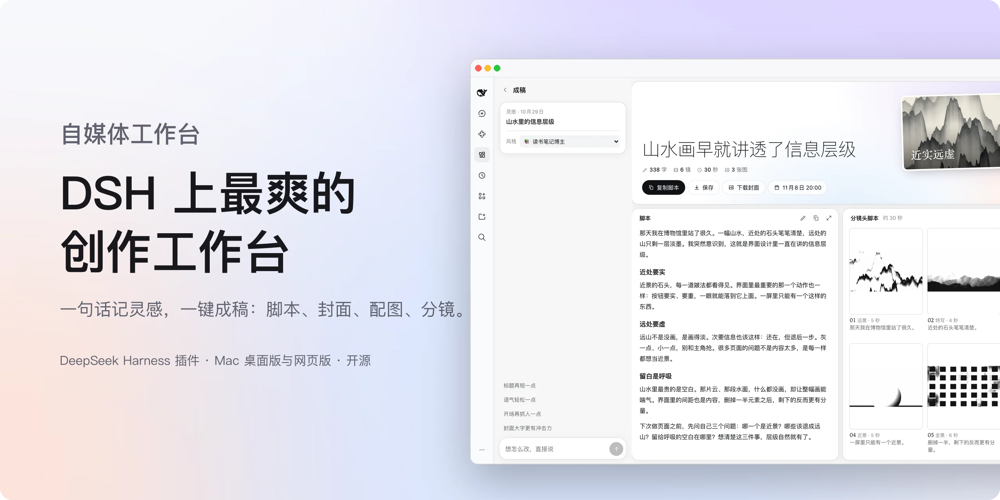
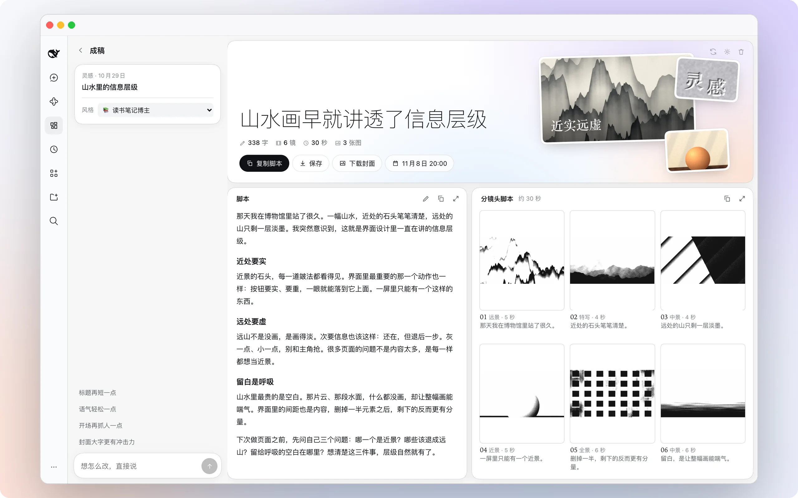
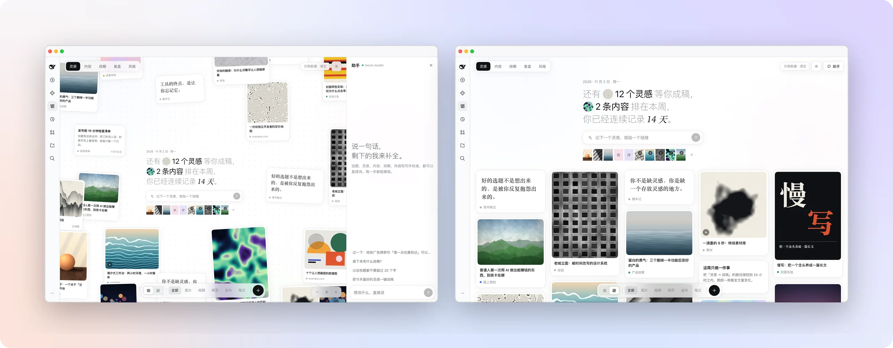
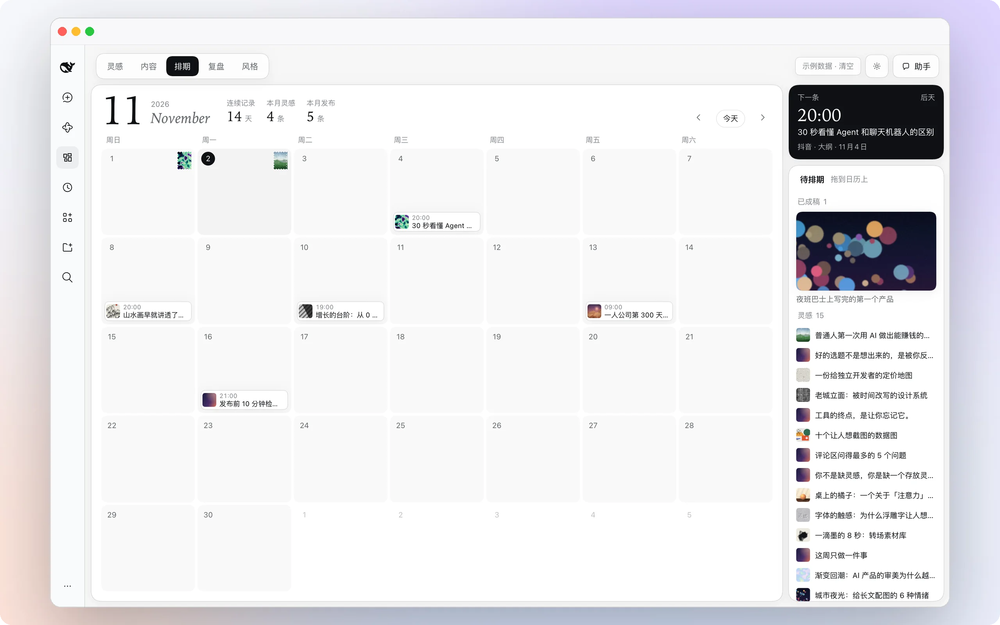
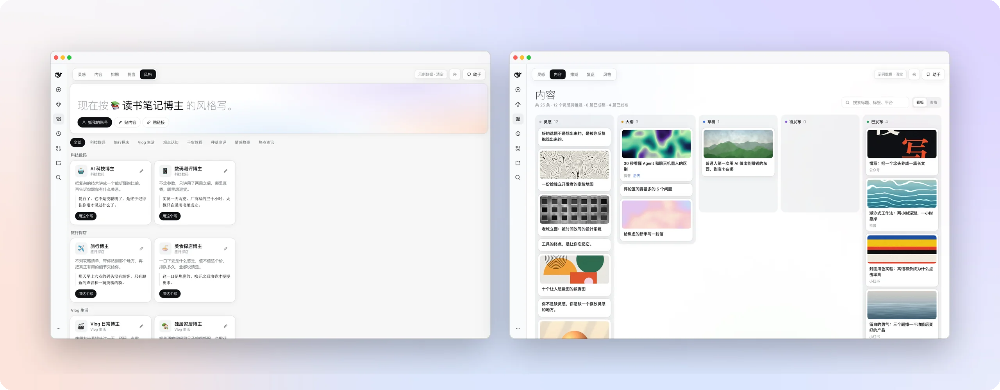

<p align="center">
  <b>简体中文</b> · <a href="README.en.md">English</a>
</p>

<p align="center">
  <picture>
    <source media="(prefers-color-scheme: dark)" srcset="docs/assets/hero-zh-dark.webp">
    
  </picture>
</p>

<p align="center">
  DeepSeek Harness 的自媒体插件。一句话记下灵感，一键生成口播脚本、标题、视频封面、配图和分镜，再用一句话改到满意。
</p>

<p align="center">
  <a href="https://github.com/woniuniuniu/dsh-media-desk/releases/latest"></a>
  <a href="LICENSE"></a>
  <a href="https://github.com/woniuniuniu/dsh-media-desk/releases/latest"></a>
  <a href="https://github.com/woniuniuniu/dsh-media-desk/stargazers"></a>
</p>

<br>

<h3 align="center">一键成稿，整页一起长出来</h3>

<p align="center">点开一个灵感，稿面的格子一开始就排好。标题、脚本、视频封面、配图和黑白线稿分镜同时生成，一边生成一边填满。</p>

<p align="center">
  <picture>
    <source media="(prefers-color-scheme: dark)" srcset="docs/assets/f-studio-dark.webp">
    
  </picture>
</p>

<p align="center"><sub>左边说一句「标题再短一点」「第 3 镜换成俯拍」，右边实时改。脚本可以直接编辑、一键复制，或者连封面和分镜一起保存成一个文件夹。</sub></p>

<br>

<h3 align="center">一句话，记下一个灵感</h3>

<p align="center">灵感散落在无限画布上，也可以按时间排成信息流。图片、视频、网页、金句、笔记，都能贴进来。右边的助手一句话能改所有东西。</p>

<p align="center">
  <picture>
    <source media="(prefers-color-scheme: dark)" srcset="docs/assets/f-home-dark.webp">
    
  </picture>
</p>

<br>

<h3 align="center">把成稿拖到日历上</h3>

<p align="center">灵感日历和发布排期是同一张日历。每天一张灵感邮票，做好的稿子从右边拖到某一天就排好了。</p>

<p align="center">
  <picture>
    <source media="(prefers-color-scheme: dark)" srcset="docs/assets/f-schedule-dark.webp">
    
  </picture>
</p>

<br>

<h3 align="center">复盘，然后把经验写进规则</h3>

<p align="center">趋势、平台分布、表现最好的内容，一眼看完。从数据里提炼出来的建议，点一下就成为以后写作都遵守的规则。</p>

<p align="center">
  <picture>
    <source media="(prefers-color-scheme: dark)" srcset="docs/assets/f-insights-dark.webp">
    
  </picture>
</p>

<br>

<h3 align="center">按谁的风格写，你说了算</h3>

<p align="center">科技数码、旅行探店、Vlog 生活、观点认知……8 个板块 15 种博主预设，选一种就能开写。抓自己的账号或贴几篇稿子，提炼出你专属的风格。内容页把所有稿子按状态排好。</p>

<p align="center">
  <picture>
    <source media="(prefers-color-scheme: dark)" srcset="docs/assets/f-style-dark.webp">
    
  </picture>
</p>

<br>

<a id="download"></a>
<h3 align="center">安装</h3>

<p align="center">从 Releases 下载安装包，一条命令装进 DeepSeek Harness。Mac 桌面版和网页版都支持。</p>

<p align="center">
  <a href="https://github.com/woniuniuniu/dsh-media-desk/releases/latest"></a>
</p>

要求 DeepSeek Harness `0.2.1-rc.5` 及以上的 `0.2.x`。把 `dsh-media-desk-*.tgz` 放到一个不会被删除的固定位置，在那个文件夹里执行。终端里没有 `dsh` 的话，先在桌面版菜单里选择「管理 dsh 命令」。

**桌面版：** 先至少打开过一次应用，然后完全退出（⌘Q），再执行，装好后重新打开。

```bash
dsh plugin --profile desktop add "file:$PWD/dsh-media-desk-2.4.0.tgz"
```

**网页版：** 执行后重新启动 `dsh web`。

```bash
dsh plugin --profile web add "file:$PWD/dsh-media-desk-2.4.0.tgz"
```

侧栏会出现「自媒体工作台」。第一次打开是示例数据，这样你能先看到每个页面的样子；点右上角「示例数据 · 清空」就换成自己的。卸载时把 `add` 换成 `remove dsh-media-desk`，你的内容保留在 `~/.dsh/media-desk/`。

## 可以做什么

- **灵感：** 一句话、一个链接、一张图或一段视频，散落在画布上或排成信息流。
- **一键成稿：** 口播脚本、标题、视频封面、配图和黑白线稿分镜同时生成，一句话实时修改，直接编辑，复制或保存成文件夹。
- **排期：** 灵感日历和发布排期合在一张日历上，成稿拖上去就排好。
- **复盘：** 手动录入、粘贴 CSV 或抓取自己的账号，看趋势、平台和最好的内容，提炼写作规则，导出成 DeepSeek Harness 的 Skill。
- **风格：** 15 种博主预设，加上从你自己的内容提炼的专属风格。
- **助手：** 任何页面的右侧都能用一句话操作，每一步都能撤销。

不会替你发布：平台没有统一接口，复制脚本或保存文件夹后自己发。

## 需要你自己准备的 Key

插件不带任何密钥，所有费用都走你自己的账号。

| 功能 | 怎么接入 | 不接入会怎样 |
| --- | --- | --- |
| 文字 | 使用 DeepSeek Harness 当前的默认模型，消耗你自己的额度 | 只能生成结构草稿 |
| 生图 | 在插件设置里填接口地址、模型和你自己的 API Key，点「试画一张」确认 | 仍会生成脚本、分镜文案和纯文字的视频封面 |
| 抓取账号（可选） | 接入第三方服务 Monid，见下文 | 可以手动录入数据，或者贴内容提炼风格 |

**生图：** 支持任何兼容 OpenAI 图片接口（`POST {接口地址}/images/generations`）的服务。设置里预填了 OpenAI、xAI、火山方舟、智谱和硅基流动的地址，也可以选「其他自定义」。预设地址没有逐家实测，模型名以各家文档为准。一次成稿默认生成 9 张图，数量可以在设置里调整。密钥只保存在本机的 `settings.json`（权限 600），不会写进内容数据，也不会发给文字模型。

## 抓取自己的账号

在「风格」或「复盘」页点抓取，贴上自己的小红书、抖音或 B 站主页链接。插件会读取最近 20 条公开内容和互动数据，放进内容和复盘，并提炼成你的风格。再抓一次只更新数字，不会重复。

这个功能通过第三方服务 [Monid](https://monid.ai) 实现，按次收费，一个账号大约几分钱。第一次使用时：

1. 把这句话发给 DeepSeek Harness 的新会话：

   ```text
   set up https://monid.ai/SKILL.md
   ```

2. 到 [Monid 后台](https://app.monid.ai/access/api-keys) 注册并创建密钥。
3. 在终端保存密钥，不要把它发在聊天里：

   ```bash
   monid keys add -k 你的密钥 -l main
   ```

插件只调用本机的 `monid` 命令，不读也不存这个密钥。

## 常见问题

<details>
<summary><b>和 DeepSeek 官方是什么关系？</b></summary>
<br>

没有关系。这是一个社区开发的 DeepSeek Harness 插件。文字由你在 DeepSeek Harness 里配置的模型生成，按你自己的账户计费。

</details>

<details>
<summary><b>我的数据在哪里？</b></summary>
<br>

全部在本机：`~/.dsh/media-desk/`。生图密钥在同目录的 `settings.json`，只保存在你的电脑上。保存成稿的文件夹默认在 `~/Documents/自媒体工作台/`，里面有脚本、分镜脚本、视频封面、配图和分镜图。

</details>

<details>
<summary><b>抓取账号安全吗？</b></summary>
<br>

请只抓取你自己的账号。账号链接会发给 Monid 和它的数据服务商，使用前请确认这符合你和相关平台的条款。只能读到公开内容，小红书和抖音的公开接口读不到播放量，复盘会改按互动来算。抓取依据的是内容列表（小红书正文约 100 字，抖音是文案，B 站大多只有标题），提炼出的风格可以再手动调整。公众号、视频号和 X 还不支持抓取，可以贴内容或贴公开链接来提炼。

</details>

<details>
<summary><b>没有生图模型也能用吗？</b></summary>
<br>

能。脚本、标题、分镜文案照常生成，视频封面会用封面大字合成一张纯文字版。接入生图模型后，封面、配图和分镜图都会画出来。

</details>

## 开发

```bash
npm install
npm test                   # Host 逻辑测试
npm run build              # 打包前端到 dist/
npm run watch              # 监听 client/ 并重新打包
npm pack                   # 生成可安装的 tgz
scripts/dev-sandbox.sh     # 在隔离的 DSH_HOME 里启动 Web 版，不影响 ~/.dsh
node scripts/mock-llm.mjs  # 本地模拟文字和生图模型，不消耗额度
```

`scripts/mock-monid.mjs` 是一个假的 `monid` 命令，内容都是编的，用来在不花钱的情况下测试抓取流程。把它包成名为 `monid` 的可执行文件，放在 `PATH` 最前面即可。

| 路径 | 内容 |
| --- | --- |
| `client/` | 界面：灵感墙、成稿工作区、对话、内容、排期、复盘、风格、设置 |
| `src/` | Host 接口、成稿流水线、提示词、生图、风格提炼、Monid 抓取、本地存储 |
| `scripts/` | 打包、沙盒、模拟模型、示例素材生成 |
| `assets/` | 示例图片和视频，全部由 `scripts/gen-assets.py` 程序绘制 |
| `docs/assets/` | 本页用到的展示图 |

修改 `src/` 下的 Host 代码后需要重启 DeepSeek Harness。

## 安全

- 每个 `/media-desk/*` 请求都经过 Host 鉴权，默认拒绝。
- 模型输出和抓取到的内容都当作不可信数据：只取固定字段并限制长度，操作走白名单校验。
- 粘贴的链接不能访问本机和内网地址，每次跳转都会重新检查。
- 调用 `monid` 时不经过 shell，端点和条数都是写死的，账号 ID 只接受固定格式。

发现安全问题请通过 [Security Advisories](https://github.com/woniuniuniu/dsh-media-desk/security/advisories/new) 私下报告，不要在公开 Issue 里写漏洞细节。

## 许可证

[MIT](LICENSE)。DeepSeek Harness 及其名称、标识归其所有者所有，本项目是社区插件，与 DeepSeek 没有关联。
